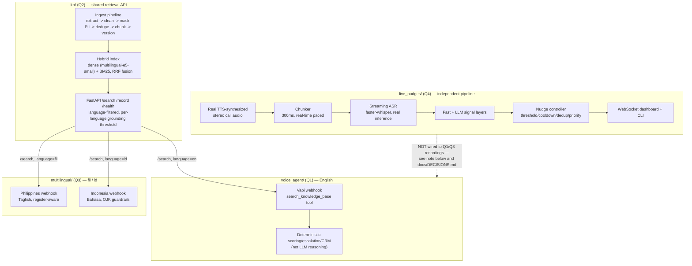

# AI Engineer Assessment — Knowledge-Grounded Voice AI Platform

> **Status: all four questions implemented, tested, and measured against
> real code — with every gap against the brief stated plainly, not
> hidden.** No live Vapi/Deepgram/Azure telephony credentials exist in
> this environment; where that matters, this README says so in the same
> sentence as the result, not in a footnote. See
> [`CLAUDE.md`](CLAUDE.md) for the engineering rules this repo follows,
> [`ai_assignment.pdf`](ai_assignment.pdf) for the original brief,
> [`docs/DECISIONS.md`](docs/DECISIONS.md) for every non-trivial choice
> with reasoning and alternatives,
> [`docs/DEFENSE_NOTES.md`](docs/DEFENSE_NOTES.md) /
> [`docs/VIDEO_SCRIPT.md`](docs/VIDEO_SCRIPT.md) for the walkthrough
> materials, and
> [`docs/SUBMISSION_CHECKLIST.md`](docs/SUBMISSION_CHECKLIST.md) for a
> line-by-line audit against the brief's exact requirements — including
> what's genuinely not done yet, stated plainly.

## Overview

A knowledge-grounded voice AI platform built around one shared retrieval
API (`kb/`, Q2). `voice_agent/` (Q1) uses it for outbound
health-insurance lead qualification in English; `multilingual/` (Q3)
reuses the same index with language-tagged records for a Philippines
life-insurance/bancassurance bot (Taglish) and an Indonesia multifinance
installment-reminder bot (Bahasa Indonesia). `live_nudges/` (Q4) is a
separate, real-time pipeline — real TTS-synthesized call audio through a
real local streaming ASR model — that turns a live call into in-call
agent nudges. The single most important constraint across all four: **a
bot must say "I don't know" rather than invent an answer** — checked by
an automated test in every voice component, not just prompted for
(CLAUDE.md §6).

| Folder          | Question | What it does                                                            |
|------------------|----------|--------------------------------------------------------------------------|
| [`kb/`](kb/README.md)           | Q2 | Ingests, cleans, chunks, indexes business content; exposes a retrieval API. |
| [`voice_agent/`](voice_agent/README.md)  | Q1 | Knowledge-grounded voice agent for health-insurance lead qualification. |
| [`multilingual/`](multilingual/README.md) | Q3 | Philippines (Taglish) and Indonesia (Bahasa) native-language voice bots. |
| [`live_nudges/`](live_nudges/README.md)  | Q4 | Real-time call analysis producing in-call nudges, with measured latency. |

## Architecture



**Honest note on the dotted line above**: the assignment brief allows
(does not require) reusing Q1/Q3 recordings for Q4 — "recorded calls
from Question 1 or 3 *may* be reused." This repo does **not** do that:
Q1/Q3 only ever produce text transcripts (no synthesized audio), and Q4
needed its own domain-specific scenarios (missed cross-sell, compliance
gap, rising frustration, noisy/ambiguous) that aren't what Q1/Q3's
existing scripts were built to demonstrate. Q4's pipeline is otherwise
audio-source-agnostic — feeding it a Q1/Q3 recording would work
unchanged if one existed. See `docs/DECISIONS.md`.

`voice_agent/` and `multilingual/` both call `kb/`'s `/search` directly
over HTTP (or in-process via `TestClient` for tests/simulators) — never
hardcoding KB content into a system prompt (an explicit rejection
condition per the brief). `live_nudges/` has no KB dependency: it
analyzes the *shape* of a conversation, not its factual content.

## Setup (from a fresh clone)

Prerequisites: Python 3.11, `make` (Git Bash on Windows has it; native
PowerShell does not — see note below), optionally `uv`. `live_nudges/`
additionally needs a working audio stack (this repo installs
`pyttsx3`/`faster-whisper`/`soundfile` for you via `make setup`, but
`pyttsx3` needs the OS's own TTS voices, present by default on Windows
and most Linux/macOS installs).

```bash
git clone <this-repo-url>
cd <this-repo>
cp .env.example .env        # fill in real values locally; NEVER commit .env
make setup                  # installs pinned requirements.txt (uv if available, else pip)
make test                   # runs all four components' test suites (~10-15 min — live_nudges/'s
                             # real faster-whisper tests are the slow part; see below to skip them)
```

If you only want the fast components' tests while iterating:
```bash
make test-kb test-voice-agent test-multilingual   # seconds, no real ASR model involved
```

No `.env` values are actually required to run `make test` — every test
either needs no external service, or mocks the one it would need
(Anthropic, Vapi, Deepgram/Azure). Only the scripts explicitly named
"needs a real API key" in the per-component READMEs need real values.

Per-component setup/run instructions: [`kb/README.md`](kb/README.md),
[`voice_agent/README.md`](voice_agent/README.md),
[`multilingual/README.md`](multilingual/README.md),
[`live_nudges/README.md`](live_nudges/README.md).

## Make Commands Reference

Run `make help` for the live, authoritative list (this table is a
snapshot). Grouped by component:

| Command | What it does |
|---|---|
| `make setup` / `make test` | install deps / run all 4 components' tests |
| `make ingest-kb` / `make kb-index` / `make kb-eval` | Q2: build the KB from `data/raw/` / (re)build the retrieval index / run the retrieval eval harness |
| `make kb-search q="..."` | Q2: search the KB from the command line |
| `make run-kb` | Q2: run the retrieval API (port `$KB_PORT`, default 8001) |
| `make voice-agent-sim` / `make voice-agent-hallucination-check` / `make voice-agent-test-results` | Q1: run the 5 required scenarios / the 8-question hallucination check / compile the combined report |
| `make voice-agent-create-assistant` / `-pull-transcripts` | Q1: create the Vapi assistant / pull real call transcripts (needs `VAPI_API_KEY`) |
| `make run-voice-agent` | Q1: run the webhook server (port `$VOICE_AGENT_PORT`, default 8002) |
| `make multilingual-ingest-kb` | Q3: ingest PH+ID KB seed content into the shared index |
| `make multilingual-sim-ph` / `-sim-id` | Q3: run each market's scripted scenarios |
| `make multilingual-comparison` / `-asr-bench` | Q3: compile the PH/ID comparison / run the (illustrative) ASR benchmark |
| `make multilingual-run-ph` / `-run-id` | Q3: run each market's webhook server (ports `$PH_PORT`/`$ID_PORT`) |
| `make q4-generate-audio` | Q4: render the 4 scenario WAVs + `ground_truth.yaml` (real TTS) |
| `make q4-sim scenario=<id>` | Q4: replay one scenario in real time via CLI |
| `make q4-report` | Q4: latency report (P50/P95/max + chart) + real ASR WER report |
| `make q4-quality` | Q4: precision/recall/false-positive report (3 runs/scenario) |
| `make q4-demo` | Q4: start the dashboard server and open it in a browser |
| `make clean` | remove caches/build artifacts |

**Windows note**: `make` isn't native to PowerShell. This repo was built
and run via Git Bash's `make`; if you're on native PowerShell without
Git Bash/WSL, run the underlying `python -m <module>` command shown in
each Makefile target directly instead (every target is a one-line
`$(PYTHON) -m ...` call — open the `Makefile` and copy the line).

## Sample Inputs

Concrete, copy-pasteable inputs to try against each component:

**Q2 — KB search:**
```bash
make kb-search q="what is the waiting period for pre-existing disease cover"
make kb-search q="can I add my spouse to the policy"
```

**Q1 — voice agent scenario** (see `voice_agent/sim/scenarios.py` for
the full scripts): the "objection" scenario has the customer say *"That
premium is way more expensive than what I've seen elsewhere"* (grounded
via KB) followed by *"I just don't trust insurance companies in
general"* (not in the KB — triggers the fallback, not an invented
answer). Run: `make voice-agent-sim`.

**Q3 — Philippines scenario**: a customer says *"Naku, pasensya na po,
kasi wala pa akong pera ngayon"* ("sorry, I don't have money right now")
— an objection the KB grounds via a per-language-calibrated relevance
threshold. Run: `make multilingual-sim-ph`.

**Q4 — a real call**: `make q4-sim scenario=b_compliance_gap` replays
the compliance-gap scenario's real audio in real time and prints the
transcript + nudges as they fire, e.g. the agent saying *"This plan
offers guaranteed returns, and I can promise you full approval today"*
triggers `[CRITICAL] Compliance: that oversells the product — avoid
guarantees, restate accurately.` within about one ASR window.

## Results Summary (real numbers from `/docs`)

| Metric | Result | Source | Caveat |
|---|---|---|---|
| Q2 retrieval hit@1 / hit@3 | **1.00 / 1.00** (13 queries) | `docs/q2_kb/retrieval_test_results.json` | Real, run against the live index |
| Q2 out-of-scope rejection rate | **1.00** | same | 2 deliberately out-of-scope queries |
| Q2 retrieval latency P50 / P95 | **74.1ms / 103.4ms** | same | Real, local (Chroma + BM25), well under a 300ms target |
| Q1 hallucination refusal rate | **87.5%** (7/8) | `docs/q1_voice_agent/hallucination_check.json` | 1 genuine, root-caused miss — reported, not excluded |
| Q1 required scenario coverage | **5/5 pass** | `docs/q1_voice_agent/test_results.md` | **Simulated** scripted calls against the real webhook/KB/tools — **no live Vapi account/callable number** in this environment |
| Q3 grounding rate — Philippines | **100%** (6/6 KB lookups) | `docs/q3_multilingual/comparison.md` | Simulated scenarios, real KB |
| Q3 grounding rate — Indonesia | **86%** (6/7) | same | 1 genuine paraphrase-distance retrieval miss, root-caused not hidden |
| Q3 ASR quality (WER/CER) | **Not measured** | `docs/q3_multilingual/asr_report.md` | Explicitly illustrative-only — no Deepgram/Azure credentials, no real audio for Q3 |
| Q4 ASR quality (WER/CER) | **44.9% / 22.9%** (real, measured) | `docs/q4_live_nudges/asr_accuracy.md` | Real `faster-whisper` on synthetic TTS voice audio — inflated by number-format mismatch + a stereo-bleed hallucination artifact, both explained in the report; not a claim about real-call accuracy |
| Q4 latency — ASR P50 / P95 | **834ms / 1651ms** | `docs/q4_live_nudges/latency_report.md` | Real local model inference (`tiny.en`, CPU); no live ASR provider |
| Q4 latency — signal extraction P95 | **2.0ms** | same | Real measured code-path duration |
| Q4 latency — end-to-end P50 / P95 | **649ms / 14,960ms** | same | Small sample (n=6 nudges) — P95≈max here reflects one slow outlier, not a stable tail; see report |
| Q4 nudge precision / recall | **83% / 100%** | `docs/q4_live_nudges/quality_report.md` | 15 TP / 3 FP / 0 FN across 4 scenarios × 3 runs; the 1 recurring FP is explained (keyword collision), not hidden |

## Q1 — Knowledge-Grounded Voice Agent

Use case: health-insurance lead qualification (outbound), platform: Vapi
(custom-LLM + tool-calling — see `voice_agent/README.md` "Vapi Setup
Steps" for connecting a real account; **none is available in this
environment, so there is no callable number or live web-calling
interface right now** — this is a real gap against the brief, stated
plainly, not worked around). System prompt
(`voice_agent/config/system_prompt.md`) contains zero facts — verified
by an automated test — every fact comes from the Q2 KB via
`search_knowledge_base`.

**All 5 required scenarios pass** (cooperative, objection, incomplete+
conflicting, out-of-scope, human-escalation), executed for real via
`make voice-agent-sim` against the real webhook/tools/KB — transcripts in
`recordings/voice_agent/*.md`, compiled results in
`docs/q1_voice_agent/test_results.md`. **These are simulated calls, not
recorded phone/web calls** (no live Vapi account here) — see
`voice_agent/README.md`'s Vapi Setup Steps for what running real calls
would need. **Hallucination check: 7/8 (87.5%)** — one genuine,
root-caused failure (a question about an unlisted product line matched
on a shared phrase), reported honestly, not excluded — see
`docs/DECISIONS.md`.

Qualification scoring, escalation, and CRM lead creation are all
deterministic code (`voice_agent/app/scoring.py`/`escalation.py`/`crm.py`),
not LLM reasoning — see `voice_agent/README.md` for the full architecture
and every non-obvious design call (hard-disqualifier scoring, shared
tool registry between the webhook and the simulator, in-process KB
testing, why only Anthropic is implemented for the LLM-mode simulator).
Optional business action implemented: `create_lead` (mock CRM, SQLite).

## Q2 — Knowledge Base

Full pipeline implemented and run for real: `make ingest-kb` (extract →
clean → mask PII → dedupe → chunk → version) followed by `make kb-index`
+ `make run-kb` (hybrid dense+BM25 retrieval API). Schema matches the
brief's field example exactly (`record_id`, `title`, `content`,
`category`, `source_ref`, `version`, `pii`), plus extra lineage fields —
see `kb/app/models.py`'s `KBRecord`.

Latest ingestion run against the synthetic dataset
(`docs/q2_kb/kb_cleaning_report.md`): 9 source documents (7 HTML, 2 PDF)
→ 18 chunk-level KB records (English) plus Q3's Filipino/Indonesian
records merged into the same index, 1 near-duplicate page merged, 1 PDF
page flagged `extraction_failed` (deliberate blank page), 5 records
contained PII (all masked — `docs/q2_kb/pii_report.md` has counts by
type only, no raw values).

Retrieval eval (`make kb-eval`, `docs/q2_kb/retrieval_test_results.md`):
**hit@1 = 1.00, hit@3 = 1.00, out-of-scope rejection = 1.00** across 13
queries (11 in-scope across product/policy/eligibility/FAQ/objection/
process/compliance, 2 out-of-scope), latency **P50 = 74.1ms, P95 =
103.4ms** — well under a 300ms target. The grounding threshold
(`KB_MIN_RELEVANCE_SCORE=0.84`) was calibrated against real measured
score distributions, not guessed — and that calibration has a genuinely
thin ~0.02 margin, called out honestly as the retrieval design's biggest
open risk in `docs/DECISIONS.md` and `kb/README.md`. **Working connection
to Q1/Q3 confirmed**: both call `/search` for real, not hardcoded FAQs.

Schema, taxonomy, chunking strategy, versioning, and the retrieval
architecture are documented in `kb/README.md`; every non-obvious call
(embedding model choice, dropping the `sentence-transformers` wrapper for
a reproducible bug, the numpy2 migration, Chroma/Qdrant swappability
including a real Qdrant reset bug found and fixed, RRF's k=60, the
threshold calibration and its limitation) is logged with reasoning and
alternatives in `docs/DECISIONS.md`.

## Q3 — Multilingual Voice Bots

Two markets, reusing Q2's KB architecture with language-tagged records
(`fil`, `id`) in the same retrieval index, filtered per call by an
explicit `language` parameter — never left unfiltered (see
`docs/DECISIONS.md`'s "cross-lingual ranking unreliable without explicit
filter" entry, and the Q1 regression that same gap caused once Q3's
records were merged into the shared index, also logged there and fixed).

- **Philippines**: life insurance/bancassurance premium-renewal reminder,
  English + Filipino/Tagalog + natural Taglish, register-mirrored
  (po/opo formal vs. relaxed colloquial). 5 scenarios run for real via
  `make multilingual-sim-ph` — **100% grounding rate**.
- **Indonesia**: multifinance installment reminder/collections, formal +
  colloquial Bahasa Indonesia + finance English loanwords, OJK-style
  conduct guardrails baked into the system prompt, Javanese-accented
  regional test coverage (**text-level only — no audio was synthesized
  for Q3 at all**, a real gap against the brief's "2 recorded calls per
  market" requirement — see Known Limitations). 6 scenarios via `make
  multilingual-sim-id` — **86% grounding rate** (one genuine,
  root-caused paraphrase-distance retrieval miss, not hidden).

Full comparison in `docs/q3_multilingual/comparison.md`, localization
(not translation) examples in
`docs/q3_multilingual/localization_examples.md`, ASR benchmark harness
(real code, **illustrative numbers only** — no live provider, no real
audio) in `docs/q3_multilingual/asr_report.md`. See
`multilingual/README.md` for architecture and Vapi/ASR/TTS setup steps.

## Q4 — Live Nudges

A real end-to-end pipeline, rebuilt mid-assessment from an earlier
text-only simulation once local TTS/ASR were confirmed to work with zero
live credentials (see `docs/DECISIONS.md`): `pyttsx3` synthesizes 4
scripted scenarios to real stereo WAV audio
(`recordings/live_nudges/audio/`, agent=left/customer=right channel),
`app/audio_io.py` replays them in real, paced 300ms chunks, and
`app/streaming_asr.py` runs real `faster-whisper` (`tiny.en`, CPU)
inference per rolling window — genuinely processing audio while the
call plays, not analyzing a finished recording. Two signal layers
(`app/signals_fast.py`'s config-driven keyword rules, and an optional
`app/signals_llm.py` Claude Haiku layer that reports itself as "not
configured" rather than faking a result, since no Anthropic key is set
by default) feed a nudge controller (`app/controller.py`) with per-type
confidence floors, cooldowns, a semantic-similarity duplicate check
reusing `kb/`'s embedding model, expiry, and priority preemption.
Delivery is a WebSocket dashboard (`app/main.py` + `static/dashboard.html`)
and a CLI (`replay.py`).

The 4 required scenarios (`make q4-generate-audio`, `make q4-sim
scenario=...`) cover missed cross-sell, a compliance risky-statement
*and* missing-disclosure example in one scenario, rising frustration, and
a noisy/ambiguous call with real synthesized background noise. Quality
(`docs/q4_live_nudges/quality_report.md`, `make q4-quality`) reports real
precision/recall/false-positive/negative numbers from 3 runs per
scenario against timestamp-bounded ground truth
(`live_nudges/tests/ground_truth.yaml`) derived from the actual rendered
audio: **15 true positive, 3 false positive, 0 false negative — 83%
precision, 100% recall**, identical across all 3 repeat runs per
scenario. The one recurring false positive is explained, not hidden: a
casual "sounds good" acknowledging a price quote collides with the fast
layer's buying-signal keyword list. Getting the ground-truth timestamp
tolerances right took its own real calibration pass — `faster-whisper`'s
fixed ASR windows quantize exactly when a signal fires, shifting it up
to ~9 seconds earlier than naive TTS-utterance-boundary arithmetic
predicted (see `docs/DECISIONS.md`).

Latency (`docs/q4_live_nudges/latency_report.md`, `make q4-report`):
P50/P95/max per component from a real per-hop JSONL log — `asr` P50
≈834ms / P95 ≈1651ms (real local model inference; no Deepgram/Azure
credentials in this environment, faster-whisper is the explicitly-
allowed fallback), `signal_extraction` and `llm` both ≈2ms P95.
`docs/q4_live_nudges/asr_accuracy.md` additionally reports a **real**
(not illustrative) ASR WER of 44.9% — explained, not just stated: number-
format mismatches and a stereo-channel-bleed hallucination artifact both
inflate it, both documented with actual transcript evidence.

Building this surfaced (and fixed) several real bugs worth knowing about:
a sentence split across a fixed ASR window boundary silently missed a
compliance signal (fixed with a rolling text buffer + shorter trigger
phrases), trailing audio being silently dropped when a call ends
mid-window, and an early latency-measurement bug that placed the
`audio_received` timestamp *after* ASR had already finished, making the
real inference time vanish from the report — all logged in
`docs/DECISIONS.md` with how they were found and fixed. Honest
limitations at 10x scale and with noisy/real audio in
`docs/q4_live_nudges/limitations.md`.

## Known Limitations

- **No live Vapi/Deepgram/Azure/Anthropic credentials anywhere in this
  repo by default.** Q1 has no callable number or live web-calling
  interface. Q3 has no synthesized audio at all (text transcripts only)
  — a real gap against the brief's "2 recorded calls per market."
  Q4 is a partial exception — its ASR is real (local `faster-whisper`,
  not a mock), only its LLM signal layer and the telephony side are
  unconfigured. See each component's README "Known Limitations."
- **Q4 does not reuse Q1/Q3 recordings** (allowed, not required, by the
  brief) — it has its own independently-synthesized audio. See
  `docs/DECISIONS.md` for why.
- **Cross-lingual retrieval margins are thin.** Per-language grounding
  thresholds (`kb/app/settings.py`) were calibrated on a small sample;
  Q1's language-scoping regression (found and fixed — see
  `docs/DECISIONS.md`) is a concrete example of how easily this class of
  bug reappears whenever a new language is added to a shared index.
- **Q4's ASR uses fixed-timer windows, not voice-activity detection**,
  and is measurably imperfect against even robotic TTS audio (44.9% WER,
  explained not hidden — see `docs/q4_live_nudges/asr_accuracy.md`). A
  sentence (and once, a single word) got split across a window boundary
  during testing; partly mitigated, not fully solved. Q4's single-process
  ASR model and in-process WebSocket broadcaster also don't scale to 10x
  concurrent calls without a real queue/pub-sub backbone (all detailed in
  `docs/q4_live_nudges/limitations.md`).
- **No native-speaker or compliance/legal review** of any Filipino/
  Bahasa Indonesia content, or of the OJK/IRDAI-style guardrails —
  flagged explicitly in `docs/q3_multilingual/gaps.md`.

## Production Improvement Plan

1. **Wire in real providers**, one at a time, behind the existing
   interfaces: Vapi (Q1/Q3), Deepgram/Azure ASR (Q3/Q4), Azure/ElevenLabs
   TTS (Q3) — each already has a documented setup path in its README, and
   none requires a code shape change, only credentials + a live smoke
   test (already scoped as opt-in, non-`make test`, per CLAUDE.md §9).
2. **Monitoring and observability**: structured request/response logging
   for every KB `/search` call (query, top result, score, grounded/not),
   every voice-agent tool call, and every Q4 nudge (fired + suppressed)
   — currently only visible in test output/reports, not a running
   system. Add latency/error dashboards (e.g. Grafana over
   Prometheus-scraped FastAPI metrics) so P50/P95 regressions are caught
   automatically, not only when someone re-runs `make kb-eval`/`make
   q4-report` by hand.
3. **A continuous eval pipeline, not a one-off report.** `kb/eval/`,
   `voice_agent/sim/hallucination_check.py`, and `live_nudges/scripts/
   compile_quality_report.py` are all real, but they run on-demand. Wire
   them into CI on every KB-affecting or signal-logic-affecting PR, with
   a required-to-pass threshold (e.g. hit@1 ≥ 0.9, hallucination refusal
   ≥ 0.9, nudge recall ≥ 0.9) so a regression blocks merge instead of
   being caught by a human reading a report later.
4. **PII compliance hardening.** Current PII masking (`kb/app/ingest/
   pii.py`) uses Presidio with NER disabled for non-English content (see
   `docs/DECISIONS.md`) — production would need either a multilingual
   NER model validated for Filipino/Bahasa Indonesia, or a human review
   step before any non-English content with potential PII goes live.
   Also: encrypt `data/processed/` at rest, add an audit log of who
   accessed which KB record, and a data-retention policy for call
   transcripts/recordings.
5. **Cost.** Track per-call cost: LLM tokens (voice-agent LLM mode, Q4's
   Haiku layer), ASR minutes (Deepgram/Azure/faster-whisper compute),
   TTS characters. None of this is instrumented today. A real deployment
   needs a per-tenant/per-call cost ceiling and alerting before a bug
   (e.g. a suppressed-nudge loop bug re-triggering the LLM layer every
   segment) turns into a surprise bill.
6. **Scaling**: per-call-id state and a real pub/sub backbone
   (Redis/Kafka) for `live_nudges/app/main.py`'s controller and
   WebSocket broadcaster, plus a real job queue in front of the
   call-runner, to serve 10x concurrent calls instead of rejecting a
   second one outright (detailed in
   `docs/q4_live_nudges/limitations.md`). The KB retrieval API would
   need horizontal scaling behind a load balancer once query volume
   exceeds one process's capacity — currently untested beyond a single
   local instance.
7. **Human-in-the-loop review loop**: route Q1's hallucination-check
   failures, Q4's suppressed-nudge log, and Q3's paraphrase-distance
   retrieval misses to a human reviewer queue (not just a report file),
   with a feedback mechanism that updates the KB/thresholds/keyword
   rules based on confirmed misses — closing the loop from "found in
   testing" to "fixed in production," not just documented once.
8. **A/B testing prompts and thresholds**: the qualification system
   prompt (Q1), the localized fallback phrasing (Q3), and the nudge
   confidence thresholds (Q4) are all currently single fixed
   configurations. Production would want to run controlled variants
   (e.g. two fallback phrasings, two confidence floors) against real
   traffic with a defined success metric (grounding rate, escalation
   rate, nudge-acceptance rate from agent feedback) before committing to
   one.
9. **Native-speaker and compliance/legal review** of every Filipino/
   Bahasa Indonesia string and every compliance-guardrail claim (OJK,
   IRDAI) before any of this reaches a real customer — and, per this
   session's own findings, a review of Q4's ASR-driven compliance nudges
   specifically, since a garbled transcription of a compliance-critical
   phrase is exactly the failure mode that must not go unnoticed in
   production.

## Repository Layout

```
kb/              Q2 — knowledge base pipeline + retrieval API
voice_agent/     Q1 — knowledge-grounded voice agent
multilingual/    Q3 — Philippines + Indonesia voice bots
live_nudges/     Q4 — real-time call insights (real audio + real ASR)
docs/            decisions log, defense notes, video script, per-question test results/reports
data/raw/        input documents (gitignored — may contain PII)
data/processed/  cleaned/structured outputs
recordings/      call transcripts + (Q4 only) real synthesized call audio
```

See [`CLAUDE.md`](CLAUDE.md) for the full set of engineering rules this
repo follows, [`docs/DECISIONS.md`](docs/DECISIONS.md) for every
non-trivial design choice, [`docs/DEFENSE_NOTES.md`](docs/DEFENSE_NOTES.md)
for a plain-language explanation of the biggest decisions plus likely
interview questions, and [`docs/VIDEO_SCRIPT.md`](docs/VIDEO_SCRIPT.md)
for the timed walkthrough script.
