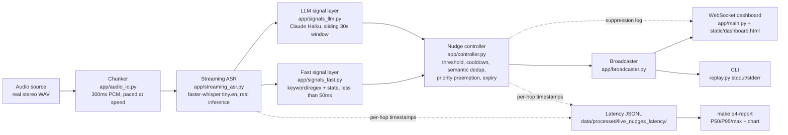

# Q4 Live Nudges: Architecture

> Note on file location: the Q4 spec asked for this at `docs/q4_architecture.md`.
> CLAUDE.md's own file-naming convention (§7) puts every question's docs
> under `docs/q{N}_*/`, so this lives at `docs/q4_live_nudges/architecture.md`
> instead — flagging the conflict rather than silently picking one, per
> CLAUDE.md's top-level instruction to follow the repo constitution and
> flag conflicts. Same reasoning applies to `quality_report.md` and
> `limitations.md` in this same directory (asked for as
> `docs/q4_quality_report.md` / `docs/q4_limitations.md`).

## End-to-end pipeline

## Diarization

Stereo files split by channel (agent = left, customer = right) — an
exact, not probabilistic, separation, since `audio_gen/scenarios_audio.py`
synthesizes the test audio with that convention. Mono files fall back to
a single "unknown" speaker channel; there is no real diarization model
(e.g. pyannote) wired in — see `limitations.md`.

## Why faster-whisper instead of Deepgram

No Deepgram/Azure Speech credentials exist in this environment (same
constraint documented for `multilingual/`'s ASR section). faster-whisper
is the explicitly-allowed local fallback: real model inference on real
audio samples, with measured (not modeled) latency — see
`docs/DECISIONS.md`.

## Two-layer signal extraction

- **Fast layer** (`app/signals_fast.py`): deterministic keyword/regex
  rules, config-driven (`live_nudges/config/disclosures.yaml`,
  `approved_offers.yaml`), stateful per call (disclosure-given,
  open cross-sell opportunities, a rolling frustration window). Runs in
  under 1ms per segment in practice.
- **LLM layer** (`app/signals_llm.py`): Claude Haiku, called on final
  segments no more than once per `llm_min_interval_seconds` (default 5s),
  over a sliding `llm_window_seconds` (default 30s) transcript window,
  returning strict JSON validated against `LLMSignalResult`. No live
  Anthropic key is configured in this environment by default — the layer
  reports itself as "not configured" and is skipped, never faked (see
  `latency_report.md`'s caveat on the `llm` row).

## Nudge control

`app/controller.py`: per-signal-type confidence floors (compliance's is
the lowest — better to over-flag it), per-topic cooldown, a semantic-
similarity duplicate check (reuses `kb/`'s multilingual-e5-small
embedding model) for same-signal-type repeats that dodge the topic-key
cooldown, expiry, and priority-sorted delivery (critical > high >
normal — priority preemption). Every suppression is logged with its
reason.
