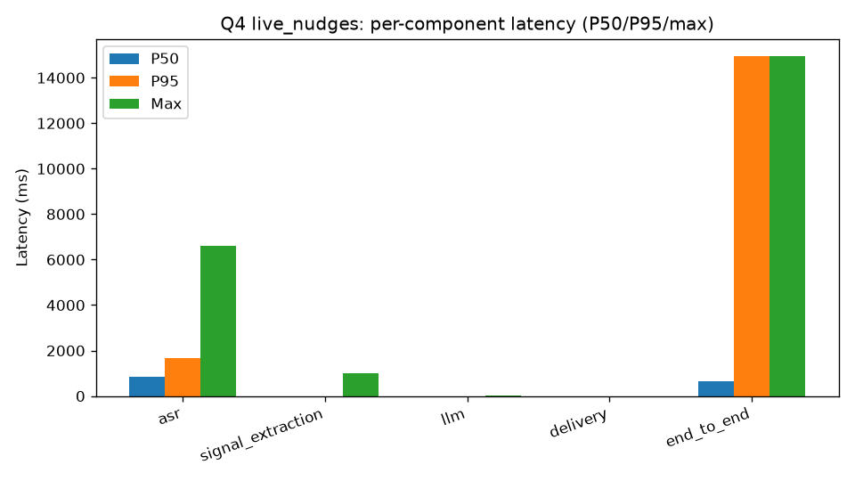

# Q4 Live Nudges: Latency Report

Measured across all 4 scripted scenarios in `live_nudges/sim/scenarios.py`, replayed at speed x20.0 via `make q4-report` (`live_nudges/scripts/compile_latency_report.py`). Speed only compresses the audio *pacing* between chunks — `asr` is real faster-whisper inference wall-clock time regardless of speed; `signal_extraction`, `llm`, and `delivery` are real measured durations of this repo's actual code paths.

| Component | Count | P50 (ms) | P95 (ms) | Max (ms) |
|---|---|---|---|---|
| asr | 218 | 834.06 | 1651.19 | 6598.61 |
| signal_extraction | 218 | 0.0 | 2.02 | 1015.03 |
| llm | 218 | 0.0 | 1.99 | 16.08 |
| delivery | 6 | 0.0 | 2.01 | 2.01 |
| end_to_end | 6 | 649.41 | 14960.28 | 14960.28 |

`end_to_end` = audio_received (a segment's window closes) -> asr_done -> signals_done -> (llm_done, if the LLM layer ran for this segment) -> nudge_created -> delivered, summed only for segments that actually produced a nudge (a segment producing zero nudges has nothing to display, so it has no end-to-end entry).

**`llm` count of 0 means the LLM layer was not configured** (no `LLM_API_KEY` in `.env` for this run) — every window was correctly skipped rather than silently faked. Set a real Anthropic key to populate this row. `asr` numbers are real local faster-whisper (`tiny.en`, CPU) inference; no Deepgram/Azure credentials exist in this environment, matching the same caveat already documented in `multilingual/README.md`'s ASR section — this repo's use of faster-whisper is the explicitly-allowed local fallback, not a workaround.
