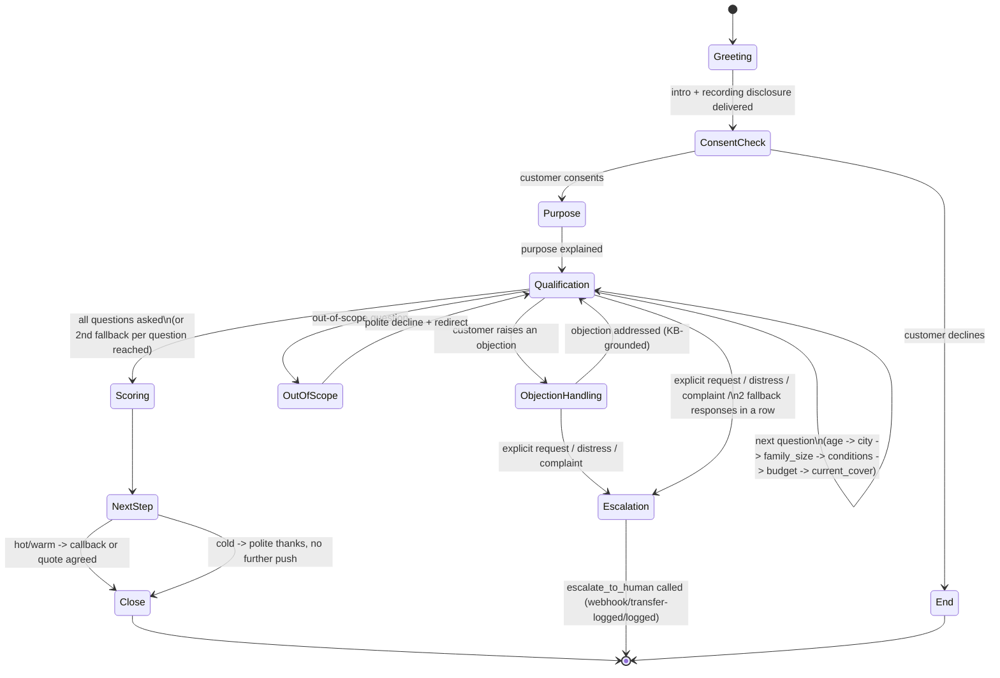

# Voice Agent Conversation Flow (Q1)

State machine for the health-insurance lead qualification outbound call.
Implemented as prompt-level instructions (`voice_agent/config/
system_prompt.md`) plus code-level logic (`voice_agent/app/scoring.py`,
`tools.py`) — the LLM follows this flow conversationally; qualification
scoring itself is deterministic code, not prompt reasoning.

## State Diagram

## States, narrated

1. **Greeting** — introduce self + Acme Insurance, state the call is
   recorded for quality/training purposes (this exact disclosure
   requirement is a grounded KB fact — see
   `docs/q2_kb/...` category `compliance_disclosure` — not hardcoded in
   the prompt).
2. **ConsentCheck** — ask for a moment of their time. A decline ends the
   call politely; this is the only state where the call can end without
   qualification.
3. **Purpose** — one or two sentences on why calling.
4. **Qualification** — one question at a time: age, city, family size,
   pre-existing conditions, budget, current cover. Loops on itself until
   all questions are asked or an escalation/objection/out-of-scope
   detour happens.
5. **ObjectionHandling** — triggered mid-qualification by any objection.
   Every response here is grounded via `search_knowledge_base` — never
   the model's own reasoning about pricing or policy. Returns to
   Qualification once addressed, or escalates on distress/complaint.
6. **OutOfScope** — legal/medical/tax advice, competitor products, or
   anything unrelated to this call: polite decline + redirect back to
   Qualification, never answered.
7. **Scoring** — `score_lead(...)` is called once (deterministic code,
   `voice_agent/app/scoring.py`), not asked again mid-call.
8. **NextStep** — hot/warm leads: offer a callback (`schedule_callback`)
   or note interest for a quote; cold leads: thank them without pushing
   further. Either way, `create_lead(...)` records the outcome.
9. **Close** — summarize what was agreed, thank them, end warmly.
10. **Escalation** — reachable from Qualification or ObjectionHandling;
    calls `escalate_to_human(reason, context)` and ends the call flow
    (human takes over, or is logged for the demo — see
    `voice_agent/app/escalation.py`).

## Cross-cutting behaviors (not separate states)

- **Interruptions**: the agent stops talking immediately and responds to
  what the customer just said — this is a turn-taking behavior instructed
  in the system prompt, not a state transition (Vapi's platform handles
  actual audio-level interrupt detection; the prompt instructs the model
  not to "talk over" or repeat itself once interrupted).
- **Incomplete information**: if a qualification answer is missing or
  unclear, ask **one** clarifying follow-up. If still unclear, **move on**
  — do not ask a third time. This is a hard rule in the system prompt,
  and is also why `score_lead` tolerates every field being `None` (see
  `voice_agent/tests/test_scoring.py::test_all_missing_fields_does_not_crash_and_is_cold`).
- **Conflicting information** (e.g. stated age 25 but "I'm retired"):
  point out the inconsistency politely and ask the customer to confirm
  which is correct — never silently pick one and move on.
- **2 fallbacks in a row → escalate**: if `search_knowledge_base` returns
  `grounded=false` twice in the same call (regardless of which questions
  triggered it), the next unresolved question escalates rather than
  attempting a third ungrounded answer.

## Why qualification logic lives in code, not the prompt

`score_lead`'s thresholds, hard-disqualifier rules, and point weights are
loaded from `voice_agent/config/qualification_rules.yaml` and evaluated
by `voice_agent/app/scoring.py` — not reasoned about by the LLM. This
means: (a) the same input always produces the same qualification
(auditable, testable, not subject to LLM sampling variance), and (b) the
business can tune thresholds without touching the prompt or risking the
LLM reinterpreting a rule differently call to call.
