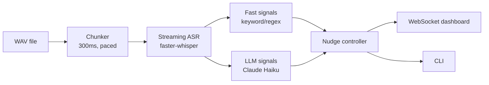

# live_nudges/ — Live Insights and Nudges From Call Audio (Q4)

> Status: **real end-to-end pipeline** — real TTS-synthesized stereo call
> audio, real chunked/paced streaming, real `faster-whisper` ASR
> inference, real (config-driven) rule-based signal detection, an
> optional real Claude Haiku layer (skipped, not faked, when no
> `LLM_API_KEY` is set), and a real WebSocket dashboard. No live
> Deepgram/Azure/Anthropic credentials exist in this environment by
> default — every place that matters says so explicitly rather than
> faking a number. See Known Limitations before treating any of this as
> production-grade.

## Overview

Audio flows through this pipeline exactly as it would arrive on a real
call: `app/audio_io.py` replays a WAV file in real, paced 300ms chunks
(never reading the whole file up front), `app/streaming_asr.py` runs a
real local ASR model per rolling window as audio arrives, and every
downstream stage only ever sees audio that has already "played." This is
what satisfies CLAUDE.md §5 Q4's explicit requirement — analyzing a
finished recording after upload does not qualify, and this doesn't do
that.



Full diagram with more detail: [`docs/q4_live_nudges/architecture.md`](../docs/q4_live_nudges/architecture.md).

## Real audio, no live provider credentials

- **TTS**: `pyttsx3` (local Windows SAPI5, 2 distinct voices) synthesizes
  the 4 required scenarios to real stereo WAV files —
  `recordings/live_nudges/audio/*.wav`, agent on the left channel,
  customer on the right (exact, not probabilistic, diarization). No TTS
  provider account needed.
- **ASR**: `faster-whisper` (`tiny.en`, CPU) — the explicitly-allowed
  local fallback to Deepgram/Azure, per the assignment brief. Real model
  inference, real measured latency, no API key. See
  `docs/q4_live_nudges/limitations.md` for the real ASR artifacts found
  while building this (a sentence split across a window boundary, a word
  garbled mid-window) and how they were handled/documented.
- **LLM signal layer**: reuses `voice_agent/`'s Anthropic credentials
  (`LLM_API_KEY`/`LLM_MODEL` in `.env`). Unconfigured by default in this
  environment — every report says so explicitly (see
  `docs/q4_live_nudges/latency_report.md`'s `llm` row) rather than
  faking a number.

## Signals Detected

Two layers, per the spec:

- **Fast layer** (`app/signals_fast.py`) — deterministic keyword/regex
  rules, config-driven (`live_nudges/config/disclosures.yaml`,
  `approved_offers.yaml` — never hardcoded Python lists). Runs in well
  under 1ms per segment (measured — see `latency_report.md`).
- **LLM layer** (`app/signals_llm.py`) — Claude Haiku, called on final
  segments no more than once per `LLM_MIN_INTERVAL_SECONDS` (default 5s)
  over a sliding `LLM_WINDOW_SECONDS` (default 30s) window, returning
  strict JSON validated against a pydantic schema
  (`LLMSignalResult`) — anything that fails validation is treated as "no
  signal for this window," never a best-effort guess.

| Signal | Trigger |
|---|---|
| Missed cross-sell | Customer mentions spouse/family/second vehicle (config-driven trigger phrases); agent never offers the matching approved plan before closing. |
| Compliance risk — risky statement | Agent says an oversell/guarantee phrase ("guaranteed returns"). |
| Compliance risk — missing disclosure | Agent reaches a closing/payment phrase without the disclosure state (`disclosure_done`) ever having been set. |
| Frustration | 2+ frustration-keyword hits from the customer within a rolling window. |
| Buying signal | Customer says a clear buying phrase. |
| Callback needed | Customer asks to be called back / says it's a bad time. |
| Payment difficulty | Customer mentions financial difficulty. |
| Intent/topic shift | Customer's topic bucket changes — low confidence by design, usually suppressed unless corroborated (see Nudge Control). |

## Nudge Control (`app/controller.py`)

- **Per-signal-type confidence floors** — compliance's is the lowest
  (better to over-flag a compliance risk than miss one); intent-shift's
  is the highest.
- **Duplicate suppression**: per-topic cooldown, *plus* a semantic-
  similarity check (reusing `kb/`'s already-loaded multilingual-e5-small
  embedding model) that catches a same-signal-type repeat worded
  differently enough to dodge the topic-key cooldown.
- **Cooldowns** per topic, **expiry** for the active queue, **priority
  preemption** (critical > high > normal, dashboard/CLI always shows
  compliance first).
- **Disclosure-gated compliance**: the missing-disclosure nudge only
  fires if the disclosure genuinely hasn't been given by the time the
  call reaches a closing/payment stage — tracked as explicit
  `disclosure_given` state, not a one-shot check.
- Every suppression decision is logged with its reason (visible in the
  dashboard's suppressed-log toggle, and in
  `docs/q4_live_nudges/quality_report.md`).

## Delivery

- **WebSocket + dashboard** (`app/main.py`, `static/dashboard.html`) —
  live transcript (agent/customer), a frustration meter, active nudges
  with priority and an expiry countdown, and a suppressed-log toggle.
- **CLI** (`replay.py`) — prints transcript + nudges to stdout/stderr in
  real time; this is also the exact same core call the server runs
  in-process for the dashboard.

## Test Scenarios

The 4 required scenarios (`live_nudges/sim/scenarios.py`), rendered to
real audio via `make q4-generate-audio`: `a_missed_cross_sell`,
`b_compliance_gap` (covers both the risky-statement and
missing-disclosure compliance cases), `c_rising_frustration`,
`d_noisy_ambiguous` (real synthesized background noise mixed in via
`audio_gen/scenarios_audio.py`). Ground truth (topic + timestamp bounds,
derived from the actual rendered audio, not guessed) lives in
`live_nudges/tests/ground_truth.yaml`.

## Quality: Precision / Recall / False Positives

`docs/q4_live_nudges/quality_report.md` (`make q4-quality`) — each
scenario run 3x against the real pipeline, scored against ground truth,
with honest run-to-run variance reporting (faster-whisper's CPU decoding
is deterministic for identical audio, so 0 variance is a real,
reportable result here, not a shortcut).

## Latency

`docs/q4_live_nudges/latency_report.md`/`.json` + `latency_chart.png`
(`make q4-report`) — P50/P95/max per component (asr, signal_extraction,
llm, delivery) plus end-to-end, from a real per-hop JSONL log
(`data/processed/live_nudges_latency/`, gitignored/regenerable).

## Known Limitations

See [`docs/q4_live_nudges/limitations.md`](../docs/q4_live_nudges/limitations.md)
for the full write-up — summarized: single-process/single-model ASR and
an in-process broadcaster don't scale to 10x concurrent calls without a
real queue/pub-sub backbone; fixed-timer ASR windows can split a
sentence (or even a word) across a boundary — found and partially
mitigated (a rolling text buffer, shorter trigger phrases), not fully
solved (VAD-based windowing would be the real fix); no ASR confidence
gating; diarization here is exact-by-construction (separate synthesized
channels), not a real diarization model.

## Setup

```bash
make setup            # from repo root
```

## Run

```bash
make q4-generate-audio   # render the 4 scenario WAVs + ground_truth.yaml (only needed after editing scenarios.py)
make q4-sim scenario=b_compliance_gap   # real-time CLI demo of one scenario
make q4-demo              # start the dashboard server + open it in a browser
make q4-report             # P50/P95/max latency report + chart
make q4-quality            # precision/recall/false-positive report (3 runs per scenario)
```

## Test

```bash
make test-live-nudges
```

Tests: audio chunking/resampling/diarization-by-channel, real
faster-whisper ASR (genuine short synthesized speech, not mocked), every
fast-layer signal rule (including negative cases), the LLM layer's JSON
schema validation and graceful degrade (fake Anthropic-shaped client, no
real key needed), the nudge controller's thresholds/cooldown/semantic-
dedup/expiry/priority logic, all 4 real scripted scenarios end-to-end
against their checked-in audio, and the FastAPI dashboard/WebSocket
server.

## Metrics

`docs/q4_live_nudges/latency_report.{md,json}`,
`docs/q4_live_nudges/latency_chart.png`,
`docs/q4_live_nudges/quality_report.md`,
`docs/q4_live_nudges/architecture.md`,
`docs/q4_live_nudges/limitations.md`.
